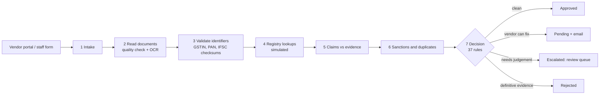
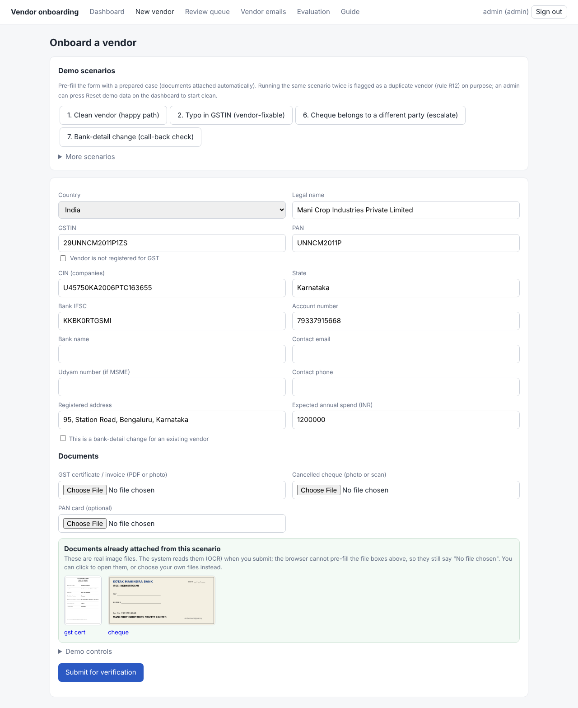
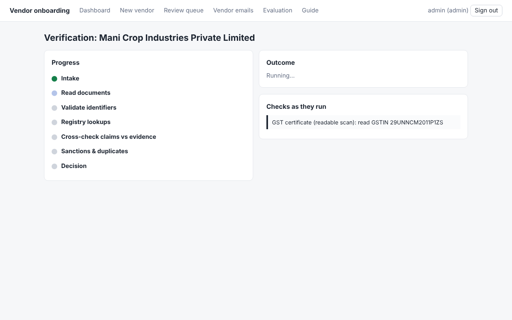
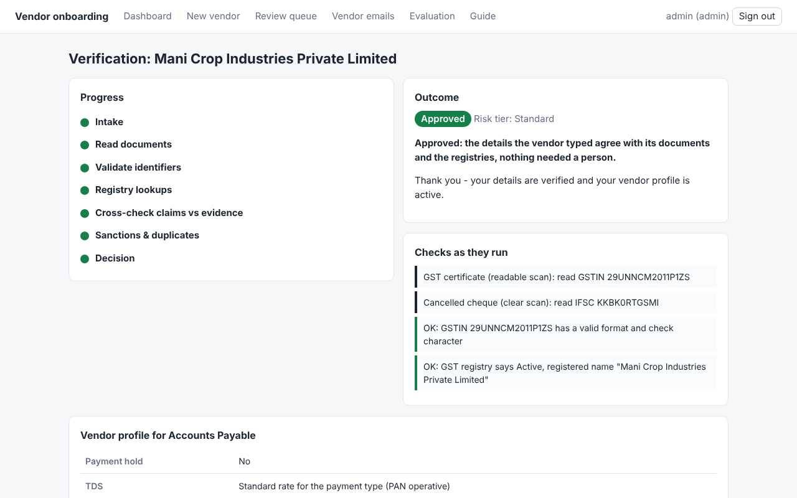
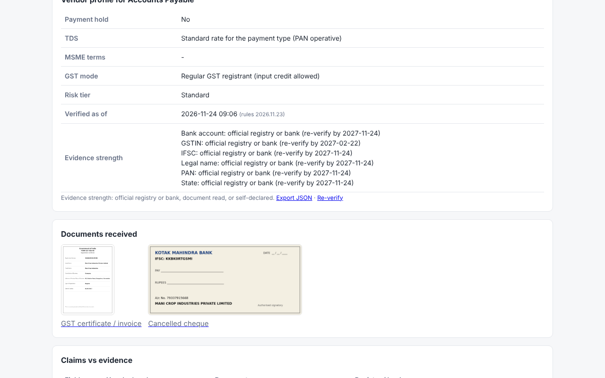
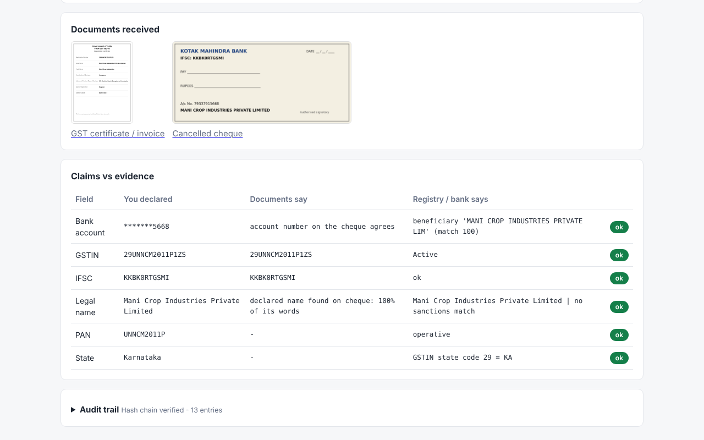
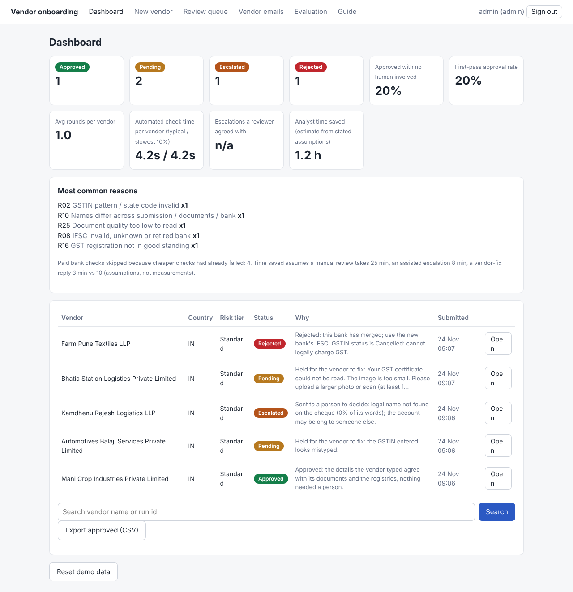

# Vendor onboarding automation (PS-2)

A working process that takes a **vendor submission** (details plus a GST certificate, a cancelled cheque and optionally a PAN card or Udyam certificate) and returns **Approved, Pending (the vendor can fix it), Escalated (a person decides) or Rejected**, with every check and the reason recorded. For anything not approved, it writes back to the vendor in plain language.

- **Live app:** https://vendoronboarding.indiasouthcentral.cloudapp.azure.com (sign in as `interviewer` / `Zamp-Demo-2026`; the login page and the [demo guide](https://vendoronboarding.indiasouthcentral.cloudapp.azure.com/guide) explain every scenario)
- **Demo video:** [Drive Link](https://drive.google.com/file/d/1KuMzgP2VpwtRWiqA_VziVwFrTq1h_ReT/view?usp=sharing)
- **Start reading here:** [The rules and why](docs/RULES.md) · [How documents are read](docs/HOW_DOCUMENTS_ARE_READ.md) · [Evidence: what I measured](docs/EVIDENCE.md) · [Design decisions](DECISIONS.md) · [Process step by step](PROCESS.md)

> **What is real and what is simulated (please read).** The documents are really read: OCR runs on every uploaded image or PDF and the values it finds are compared with what the vendor typed. The government registries (GST, PAN, Udyam, bank account verification) are **simulated**, because there is no public access to them. The IFSC bank directory, MCA company records (1.05 million), the OFAC sanctions list and the test images are real public data. Only fictional vendors can be Approved. [`docs/ROADBLOCKS.md`](docs/ROADBLOCKS.md) lists what production would need.

## The idea in four lines
1. What the vendor types is a **claim**. The documents and the registries are **evidence**. The process compares them field by field.
2. **Rules decide, no model is in the decision path.** Every outcome is explainable and repeatable. The default is Pending; Reject only on definitive evidence; anything needing judgement goes to a person.
3. **Fail safe:** a registry outage never approves, a missing document or a changed bank account or a cheque in another company's name never auto-approves, and high-risk vendors need two different approvers.
4. Cheapest checks first; the paid bank check runs last and only if everything else passed.

## How it works



Every run opens a **live run view** (each stage ticks as it executes), then shows the outcome, the vendor profile for accounts payable, the documents received, a **claims vs evidence** table and a hash-chained audit trail. A **dashboard** shows history, status, reasons and measures across runs.

| | |
|---|---|
|  |  |
|  |  |
|  |  |

More screenshots are in [`docs/img`](docs/img): review queue, vendor emails, the evaluation page, the demo guide.

## Edge cases I built (and why)
1. **A typo in the GSTIN** (fails its check digit): the commonest vendor mistake, so it costs one email, not a rejection. The message names the field and suggests the likely correct value.
2. **A cancelled cheque in another company's name:** the classic payment-diversion pattern, so it is escalated to a person, never guessed.
3. **Changed bank details on an already approved vendor:** the other classic fraud, so it needs a call-back and two different approvers.
4. **A registry outage:** the result is Pending, never a pass, and the system retries on its own.

There are nine prepared scenarios in total (clean, typo, phone photo, unreadable photo, cancelled GSTIN, third-party cheque, bank change, merged-bank IFSC, outage), and you can type any vendor of your own.

## See the document reading for yourself
The reader is a plain function, so you can run it on any file:

```bash
pip install -r requirements.txt            # also needs the tesseract binary
python tools/read_document.py gst_cert samples/invoices/syn_syn_0_00922.png --expect 33IZWCN4373L2Z3
python tools/read_document.py cheque data/demo/happy_cheque.png
```
`samples/invoices` holds 12 public invoice images (clean, scanned and phone-photo quality) with their known answers in `ground_truth.json`. [`docs/EVIDENCE.md`](docs/EVIDENCE.md) shows real outputs, including the ones it gets wrong.

## What I measured (details and caveats in [docs/EVIDENCE.md](docs/EVIDENCE.md))
| What | Result | Caveat |
|---|---|---|
| GSTIN read from 90 public invoice images | **88 of 90** found (clean 29/29, scan 23/23, phone photo 36/38). Tesseract alone: 71% | Photo damage in this dataset is simulated, not real phone photos |
| Cheque vs declared bank (112 real scans, 6 labelled photos) | right claim confirmed on 101 of 112 scans and 6 of 6 photos; **every wrong claim caught** | 87 of the scans are one Axis form; misses become a hold, never an approval |
| Company names (18,500 rewrites of real MCA names) | 99.9% matched; of 716 near-identical different companies, 1 wrongly matched | Hand-built variations |
| Sanctions (12,000 real names vs the real OFAC list) | 3 hits at the chosen threshold, all one-word personal names | Recall on name variants not measured |
| Hostile text hidden in invoices (24 prompt-injection files) | 0 decisions changed, 0 foreign GSTINs accepted | Rules decide, so nothing in a document can instruct the system |
| Decision engine on labelled synthetic vendors | 0 of 1,548 healthy variants wrongly held; 3,032 of 3,032 injected defects caught | I wrote both the cases and the rules, so this proves the plumbing, not real-world accuracy |

## Run it
```bash
pip install -r requirements.txt
python make_demo.py && python app.py       # http://localhost:8000, sign in as admin / demo
python tools/run_all_tests.py              # 7 test files
```
Or with Docker: `docker build -t vendor . && docker run -p 7860:7860 vendor`.
Set `BASE_URL` (links in emails), `USERS` (real logins) and optionally `SMTP_HOST`, `SMTP_USER`, `SMTP_PASS`, `MAIL_FROM` (real email; otherwise emails are saved as drafts).

## Repository map
| Path | What it is |
|---|---|
| `engine.py` | The 37 rules and the decision (`RULES`, `run`) |
| `docread.py`, `docprep.py`, `imgquality.py`, `ocrgst.py`, `ocr_ifsc.py`, `cheque_verify.py`, `certparse.py` | Reading documents |
| `validators.py` | GSTIN, PAN, IFSC, CIN, EIN, VAT checks; company-name matching |
| `app.py`, `security.py`, `templates/` | The web app (Flask): portal, staff UI, review queue, audit log, email |
| `eval/` | 13 evaluation scripts on real public data; results in `data/real/*.json` and `docs/results/` |
| `tests/` | 7 test files; `python tools/run_all_tests.py` |
| `docs/` | [Data sources and licences](docs/DATA_SOURCES.md), [roadblocks](docs/ROADBLOCKS.md), evidence, screenshots |

## Limits I know about
Registries are simulated. US and UK vendors get format checks only and always go to a person. Sanctions screening is OFAC only. Name matching has no real labelled accounts-payable data behind it, so its thresholds (85 / 60) are starting points to tune in shadow mode. Real phone photos of real certificates were not available to test, and the one real-cheque result that is weak is IFSC reading on small print (4 of 12 verified directly), which is why cheques are verified against the claimed bank using several signals instead.

## How I used AI
See the last section of [DECISIONS.md](DECISIONS.md).


## Data
Every dataset, its source, licence and where it is stored: [`data/README.md`](data/README.md). Large public sets are linked with a fetch script (`tools/fetch_data.py`); the curated labels and calibration files are stored in `data/real/`.
